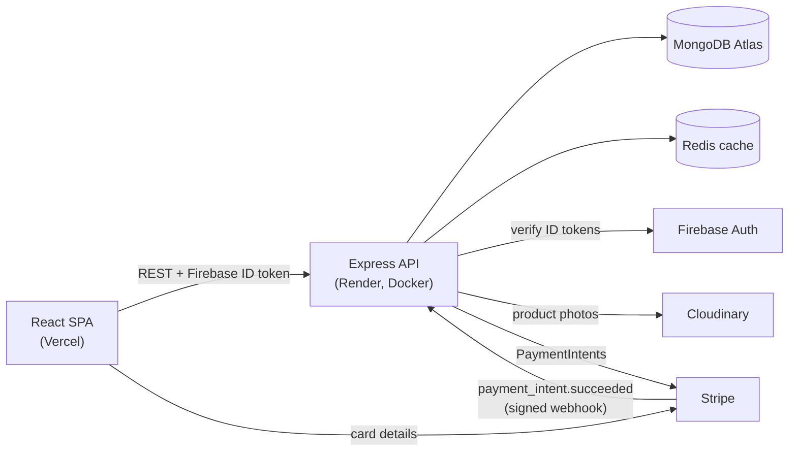
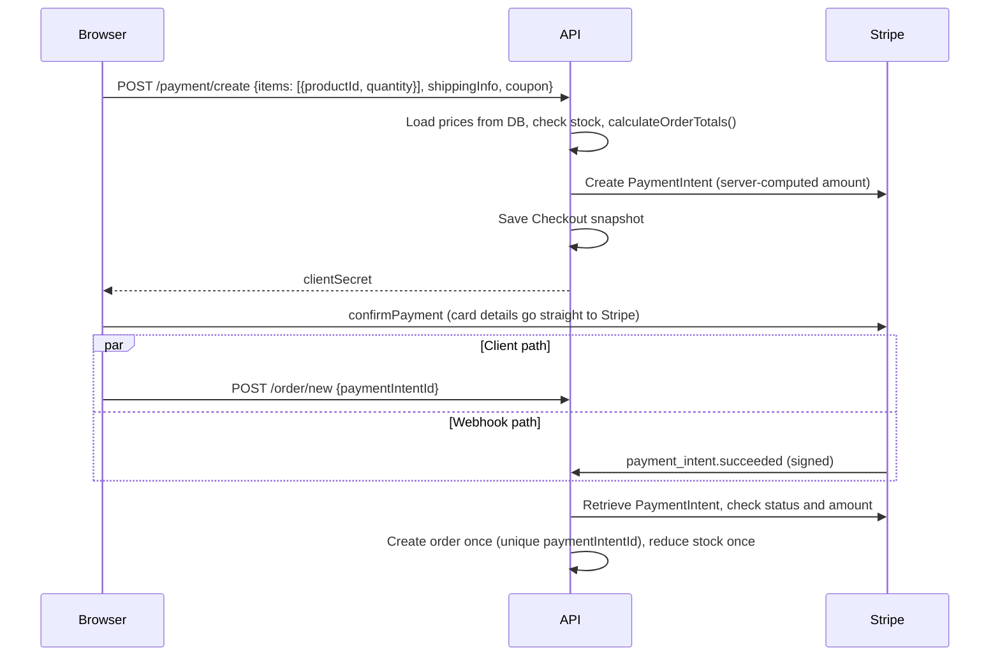

# ShopSphere API

[](https://github.com/iyogisharma001/mern-ecommerce-backend/actions/workflows/ci.yml)


REST API behind **ShopSphere**, a full-stack e-commerce store: product catalogue and search, Google sign-in, Stripe checkout, order tracking and an admin dashboard with sales analytics.

**[Live store](https://mern-ecommerce-frontend-eight-psi.vercel.app)** · **[Frontend repo](https://github.com/iyogisharma001/mern-ecommerce-frontend)** · **[Deployment guide](DEPLOY.md)**

Built by **Yogesh Sharma** ([GitHub](https://github.com/iyogisharma001) · [LinkedIn](https://www.linkedin.com/in/yogesh-sharma-597466325/)).

---

## Architecture



## Engineering highlights

- **The server sets every price.** The client only sends product IDs and quantities. The API loads prices from MongoDB, applies tax, shipping and coupons in one tested function (`calculateOrderTotals`), and stores a `Checkout` snapshot next to the Stripe PaymentIntent. Changing prices in the browser has no effect.
- **Payments are verified before an order exists.** An order is only built from the server-side snapshot, after Stripe confirms the PaymentIntent succeeded and the paid amount matches.
- **Exactly one order per payment.** Orders are created from two paths: the client after `confirmPayment`, and a signed Stripe webhook for when the customer closes the tab or is redirected for 3-D Secure. A unique index on `paymentIntentId` plus a conditional `stockReduced` claim make retries and races safe: stock is reduced exactly once.
- **Stock can't go negative.** Stock decrements are atomic (`updateOne` with a `stock >= quantity` guard), so two buyers can't both take the last unit.
- **Trusted identity.** Every protected route verifies a Firebase ID token (`Authorization: Bearer`). User IDs are never taken from the URL or body, and admin routes check the role stored in MongoDB.
- **Redis read-through cache** for catalogue, product, order and dashboard reads, with targeted invalidation on every write and a startup sweep of this app's keys (never `FLUSHDB`).
- **Hardened by default.** Helmet security headers, per-IP rate limits (stricter on sign-up and payment creation), ReDoS-safe search (user input is escaped before `$regex`), image-only uploads capped at 5 MB, a JSON body limit, and abandoned checkouts removed by a MongoDB TTL index after 2 days.
- **Tested and checked in CI.** Pricing, coupons, country codes, validation and dashboard maths are covered by Vitest unit tests. GitHub Actions type-checks, tests, builds and builds the Docker image on every push.

## Checkout flow



## API reference

Base URL: `/api/v1`. 🔒 = needs a Firebase ID token, 👑 = admin only.

| Method | Endpoint | Description |
|---|---|---|
| GET | `/health` | Service status (database and cache) |
| **Products** | | |
| GET | `/product/latest` | 8 newest products |
| GET | `/product/all?search=&category=&price=&sort=asc\|dsc&page=` | Search, filter, sort and paginate; returns `total` and `totalPage` |
| GET | `/product/categories` | All categories |
| GET | `/product/:id` | One product |
| GET | `/product/reviews/:id` | Reviews for a product |
| POST | `/product/review/new/:id` 🔒 | Add or update your review |
| DELETE | `/product/review/:id` 🔒 | Delete your review |
| GET | `/product/admin-products` 👑 | All products |
| POST | `/product/new` 👑 | Create product (multipart, up to 5 photos) |
| PUT / DELETE | `/product/:id` 👑 | Update or delete a product |
| **Users** | | |
| POST | `/user/new` 🔒 | Sign up or sign in (identity comes from the verified token) |
| GET | `/user/:id` 🔒 | Your own profile (admins: anyone) |
| GET | `/user/all` 👑 | All users |
| DELETE | `/user/:id` 👑 | Delete a user |
| **Payments and coupons** | | |
| POST | `/payment/create` 🔒 | Price the cart and create a Stripe PaymentIntent |
| POST | `/payment/webhook` | Stripe webhook (signature-verified, raw body) |
| GET | `/payment/discount?coupon=` | Check a coupon |
| GET / POST / PUT / DELETE | `/payment/coupon/...` 👑 | Manage coupons |
| **Orders** | | |
| POST | `/order/new` 🔒 | Confirm an order after payment `{paymentIntentId}` |
| GET | `/order/my` 🔒 | Your orders |
| GET | `/order/:id` 🔒 | One order (owner or admin) |
| GET | `/order/all` 👑 | All orders |
| PUT / DELETE | `/order/:id` 👑 | Advance status (Processing → Shipped → Delivered) or delete |
| **Dashboard** 👑 | | |
| GET | `/dashboard/stats` | Revenue, counts, month-over-month change, latest transactions |
| GET | `/dashboard/pie` · `/bar` · `/line` | Chart data |

## Project structure

```
src/
├── app.ts               # Express setup: security, CORS, routes, error handling
├── controllers/         # Route handlers (product, order, payment, user, stats)
├── middlewares/         # auth (Firebase), error handler, multer uploads, rate limits
├── models/              # Mongoose schemas (Product, Order, Checkout, User, Review, Coupon)
├── routes/              # Express routers
├── scripts/seed.ts      # Demo catalogue (24 products)
└── utils/
    ├── helpers.ts       # Pure business rules (unit tested)
    ├── helpers.test.ts
    └── features.ts      # Cache, stock, checkout finalisation, Cloudinary
```

## Run it locally

**Requirements:** Node.js 20+, plus MongoDB and Redis (Docker is easiest):

```bash
docker run -d --name shop-mongo -p 27017:27017 mongo:7
```

```bash
docker run -d --name shop-redis -p 6379:6379 redis:7-alpine
```

**1. Install and configure**

```bash
npm install
```

Copy `.env.sample` to `.env` and fill it in:

| Variable | Example / where to get it |
|---|---|
| `PORT` | `4000` |
| `MONGO_URI` | `mongodb://localhost:27017` or an Atlas `mongodb+srv://` string |
| `REDIS_URI` | `redis://localhost:6379` |
| `CLIENT_URL` | `http://localhost:5173` (comma-separate several origins) |
| `STRIPE_KEY` | Stripe test secret key `sk_test_...` |
| `STRIPE_WEBHOOK_SECRET` | `whsec_...` from Stripe (or the Stripe CLI) |
| `CLOUD_NAME`, `CLOUD_API_KEY`, `CLOUD_API_SECRET` | Cloudinary dashboard |
| `FIREBASE_PROJECT_ID`, `FIREBASE_CLIENT_EMAIL`, `FIREBASE_PRIVATE_KEY` | Firebase service account JSON |

**2. Add demo products and start**

```bash
npm run seed -- --no-upload
```

```bash
npm run dev
```

The API runs on `http://localhost:4000`. To test webhooks locally: `stripe listen --forward-to localhost:4000/api/v1/payment/webhook`.

## Scripts

| Command | What it does |
|---|---|
| `npm run dev` | Start with auto-reload (tsx) |
| `npm test` | Run unit tests (Vitest) |
| `npm run typecheck` | TypeScript check |
| `npm run build` / `npm start` | Compile to `dist/` and run it |
| `npm run seed` | Add 24 demo products. `--no-upload` keeps the original image URLs; without it, photos are copied to your Cloudinary; `--dry` previews |

## Deployment

Render (Docker web service plus a free Redis, defined in [`render.yaml`](render.yaml)), with the frontend on Vercel. Step-by-step: **[DEPLOY.md](DEPLOY.md)**.

## Possible next steps

- Integration tests against an in-memory MongoDB (supertest + mongodb-memory-server)
- Cursor-based pagination and a text index for search at larger catalogue sizes
- Email order confirmations

---

Demo product data comes from [DummyJSON](https://dummyjson.com), a free dataset for testing shops. Payments run in Stripe test mode, so no real money moves.
